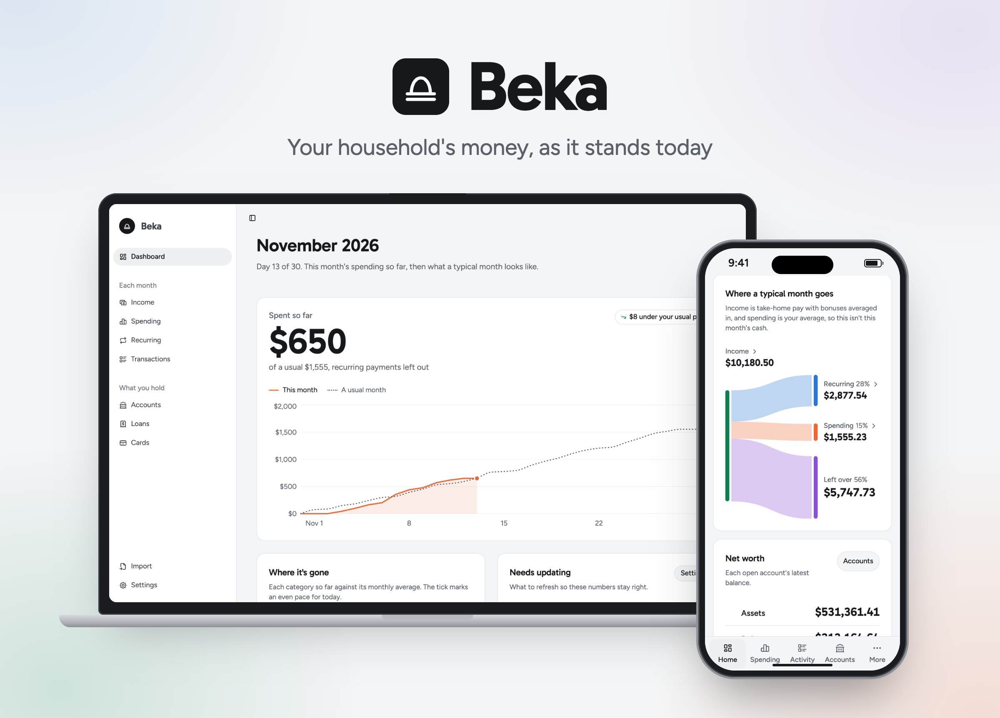

# Beka

A self-hosted app that shows your household's current financial picture: what each paycheck deposits, what you spend by category each month, your recurring payments, accounts and net worth, loans ranked by interest rate, and which credit card earns the most where.



Beka shows where things stand today; it doesn't plan or forecast. Its data is available to an AI agent so you can ask questions about your finances.

The name is the beka of Exodus 38:26, half a shekel paid by "every one that went to be numbered": money for counting a household.

## What it tracks

- **Dashboard**: your month at a glance. What you've spent so far this month, drawn day by day against a usual month, with how far under or over your usual pace you are; each category so far against its average, in the category's own color; anything that needs updating, like an old balance, a month of transactions not imported yet, or a recurring payment that may have ended; deposits and recurring charges in the next two weeks; where a typical month goes, drawn as a flow from each paycheck into income and out to recurring payments, spending (a 12-month average), and what's left over; and net worth from your latest balances.
- **Income**: each job's pay, pay schedule, Form W-4, state and local tax, deductions (401(k), HSA, insurance premiums, …), employer contributions, bonus, and deposit splits. Beka works out federal withholding, Social Security, and Medicare the way payroll does, so you see exactly what each paycheck deposits and where the rest of your gross goes, with a calendar of every deposit this year that checks each one against the deposits you've uploaded, matching each payer's deposit to its own transaction. Income outside payroll, like a pension or rent, is entered as the amount deposited.
- **Transactions**: upload a CSV of already-categorized transactions (date, merchant, description, amount, category, account, notes). A preview flags problems and rows categorized differently than usual before anything is saved, transactions already imported are skipped, and any import can be undone. Something no upload will carry, like a cash purchase, can be added by hand. The Import page gives you instructions for the AI that prepares your uploads, including how you've categorized each merchant so far. Categories start from Rocket Money's list and are each counted as spending, income, or excluded (transfers, card payments, investing). Each spending category has a color that marks it on the Dashboard and Spending pages; manage categories and their colors in Settings → Categories.
- **Spending**: what you spend in each category each month over the last 12 complete months (or any calendar year), with each category's monthly average and share, a chart of monthly totals, and this month so far shown apart. Recurring payments are left out so the numbers match the Dashboard; a toggle adds them back. Click any amount to see its transactions.
- **Recurring**: payments that repeat, like subscriptions, utilities, insurance, and loan payments. Beka spots merchants charging on a steady schedule and asks once whether each is recurring; after that their charges are flagged automatically (they keep their categories). Bills that swing count at their yearly average, yearly payments count a twelfth a month, card annual fees are added for you, and Beka asks when an expected charge stops showing up. You can add payments your uploads won't show by hand.
- **Accounts**: checking, savings, brokerage, retirement, HSA, and property like your home or vehicles. You enter balances by hand with the date they were true; every update is kept as history, and closed accounts can be archived. Each group shows its total, and together they add up to your net worth.
- **Loans**: interest rate, minimum payment, and balance owed for each loan, ranked by interest rate (or smallest balance) so you know where extra cash should go, with each loan's monthly interest cost.
- **Cards**: each card's rewards (cash back or points at the value you choose, bonus categories with caps and conditions, rotating quarterly categories), fees, and credits, with a "Which card?" guide showing the best card for each category. Cards that carry a balance join the loan ranking at their APR.
- **Light and dark themes**: follow the device, or pick one in Settings → Appearance. Each device remembers its choice.

## Asking an AI agent

Beka shows where things stand; for questions like "can we afford a house?", connect an AI agent. It reads and updates your data over [MCP](https://modelcontextprotocol.io):

1. In Settings → Agent access, create a key. It's shown once.
2. Point your agent at `https://<your-beka-address>/mcp` with the key as a Bearer token. For Claude Code:

   ```sh
   claude mcp add --transport http beka https://<your-beka-address>/mcp --header "Authorization: Bearer <key>"
   ```

The agent starts from an overview of your month and what's out of date, can run read-only SQL against the database, gets computed paychecks, spending, recurring payments, debts, and card picks, and can make the same changes you can in the app (record a balance, import transactions, recategorize, …). Its changes are marked "Agent" in Settings → Change log. The endpoint works whether or not a household password is set; the key is what protects it.

## Backups

Beka copies its database into `$DATA_DIR/backups` once a day and keeps 30 days of copies. Settings → Backups lists them and can back up now, download any backup, or restore one (or a file you upload). A restore first backs up the data it replaces, so you can switch back. A backup holds everything in Beka, so keep copies as private as the app itself. To keep backups off the server too, copy the backups folder somewhere else on a schedule.

## Development

Requires Node 26 and pnpm.

```sh
pnpm install
pnpm dev
```

To fill a dev database with a sample household (two people, a year of transactions, income, accounts, loans, and cards), run this while `pnpm dev` is running:

```sh
pnpm seed sample/seed.json            # into an empty database
pnpm seed sample/seed.json --replace  # start over
```

A seed is JSON that names people, accounts, and categories instead of numbering them; see `src/server/seed.ts` for its shape. Put seeds with real data in `local/`, which git ignores.

## Self-hosting

Run the published image with Docker Compose:

```bash
curl -O https://raw.githubusercontent.com/zhamann/beka/main/docker-compose.yml
docker compose up -d
```

Open http://localhost:4321. Images are built for `linux/amd64` and `linux/arm64`.

Set `TZ` in `docker-compose.yml` to your time zone so "today" (paydays, this month, out-of-date reminders) matches your calendar.

To use another port, change the host side of the mapping, e.g. `"8080:4321"`. To reach it only through a reverse proxy on the same machine, bind it to loopback with `"127.0.0.1:4321:4321"`.

### Keeping it private

Beka holds your financial details, so keep it on a private network (like Tailscale), set `BEKA_PASSWORD`, or both, and serve it over HTTPS if it's reachable from outside your home.

- **Without a password**, Beka answers only at addresses that can't belong to another site: `localhost`, IP addresses, single-word names like `nas`, and names ending in `.local`, `.lan`, `.home`, `.internal`, `.home.arpa`, or `.ts.net`. This stops a web page you visit from pointing its own name at your server (DNS rebinding) and reading your data. To use another name, like `beka.example.com` on your home network, list it in `BEKA_HOSTS`.
- **With a password**, each device signs in once and stays signed in for 400 days. Wrong passwords are checked one at a time, a second apart. To sign every device out, change the password.
- **Agent keys** reach only `/mcp`. Each one can be revoked in Settings → Agent access.

### Behind a reverse proxy

Point the proxy at port 4321 and pass the original `Host` header and `X-Forwarded-Proto`, which Caddy does by default. With nginx:

```nginx
location / {
    proxy_pass http://127.0.0.1:4321;
    proxy_set_header Host $host;
    proxy_set_header X-Forwarded-Proto $scheme;
    client_max_body_size 200m; # restoring an uploaded backup
}
```

Beka then sees the address people open it at, so restores and sign-in work and the sign-in cookie is only sent over HTTPS.

### Without Docker

Requires Node 26 and pnpm.

```sh
pnpm install --frozen-lockfile
pnpm build
HOST=0.0.0.0 DATA_DIR=/var/lib/beka node ./dist/server/entry.mjs
```

Run it under a service manager like systemd so it restarts with the machine.

### Data

The database and its daily backups live in `/data` inside the container, which Compose mounts from the `beka-data` volume, so they survive restarts, upgrades, and recreating the container. See [Backups](#backups) for restoring.

### Upgrading

```bash
docker compose pull
docker compose up -d
```

The new container uses the same volume and applies any database migrations when it starts. Each January's release adds that year's federal tax tables; until you upgrade, the Dashboard reminds you that paychecks use the previous year's.

## Configuration

| Variable        | Default     | What it does                                                                                                      |
| --------------- | ----------- | ----------------------------------------------------------------------------------------------------------------- |
| `DATA_DIR`      | `./data`    | Where the database and its backups are stored (`/data` in the image).                                             |
| `TZ`            | system      | The time zone "today" is worked out in.                                                                           |
| `HOST`          | `localhost` | The address the server listens on; `0.0.0.0` (the image's default) listens on every network.                      |
| `PORT`          | `4321`      | The port the server listens on.                                                                                   |
| `BEKA_PASSWORD` | unset       | A household password. When set, each device signs in once; leave it unset to rely on your network for privacy.    |
| `BEKA_HOSTS`    | unset       | Other host names to answer at without a password, comma-separated. See [Keeping it private](#keeping-it-private). |

## License

[AGPL-3.0](LICENSE)
